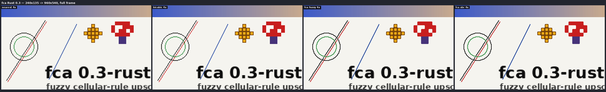
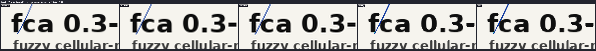
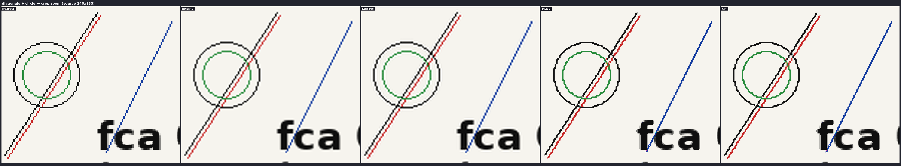
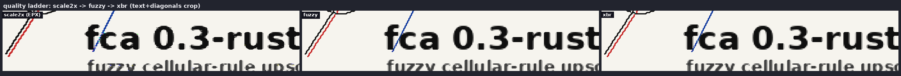
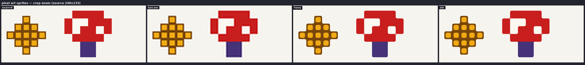

<div align="center">

# libfca — upscaling на нечётких клеточных правилах

**CPU-апскейлер 2x на целых числах для старого видео и аниме: edge-directed
масштабирование с нечётким членством, темпоральным кэшем тайлов и VSR-фузией.
Без ML, без GPU, без float-математики — детерминированно, только целые числа.**

[](https://github.com/kostyk348/fca/releases)
[](https://github.com/kostyk348/fca/actions/workflows/ci.yml)
[](#разработка)
[](LICENSE)
[](https://www.rust-lang.org)
[](CONTRIBUTING.md)

[English](README.md) · **Русский**

</div>

---

Построено на парадигме EAFAR (`kostyk348/eafar`): S5 — нечёткое членство вместо
булевых решений, S3 — sleep/wake-планирование регионов для темпоральной
стабильности, S7 — пре-фильтрация в духе diffusion. Само правило масштабирования —
клеточный автомат над сеткой пикселей (концепция AVX-FCA).

## Правила (лестница качества)

| правило | идея |
|---|---|
| `scale2x` | классический EPX: правило 3x3, жёсткий выбор по толерантности (базовый) |
| `fuzzy` | мягкое смешивание по треугольному членству `m(d) = 255 - d*51>>3` — сглаженные диагонали, без мерцания на порогах |
| `xbr` | + диагональные углы (A,C,G,I) и взвешенная пара: тонкие диагональные линии 1px выживают |

Все правила разделяют один скелет: `out = mix(E, candidate, strength)`,
`strength = m(p~q) * (1-m(perp1~p)) * (1-m(perp2~q))`. Результат остаётся внутри
min/max окрестности 3x3 — звона нет по построению.

## Скриншоты

Один синтетический источник 240x135 (текст, диагонали 1px, окружности,
пиксель-арт спрайты, градиент), масштабированный 4x ржавым портом против
эталонных ресемплеров — все картинки ниже сгенерированы самим портом
(`scripts/fca_screenshots.py`, самодостаточная демка).

<p align="center">
  
</p>

Зум текста — главный тезис: буквы остаются чёткими, диагональ не превращается
в лестницу (слева направо: nearest, bicubic, lanczos, fuzzy, xbr):

<p align="center">
  
</p>

Диагонали и окружности, лестница качества и пиксель-арт:

<p align="center">
  
</p>
<p align="center">
  
</p>
<p align="center">
  
</p>

## Порт на Rust (v0.3)

Прототип был на C++20 с рукописным AVX2-путём, бит-в-бит совпадавшим со
скалярным эталоном. Порт оставляет **скалярную арифметику единственным
источником истины** (она и была спецификацией), распараллеливает строки через
rayon вместо OpenMP и убирает все C-зависимости. Корректность проверена
**бит-в-бит против C-реализации**: 5 golden-наборов (правила, вся цепочка FX,
VSR, темпоральный кэш) сгенерированы из оригинальных заголовков и зашиты в
`tests/golden.rs`.

| | C++ прототип | Rust 0.3 |
|---|---|---|
| SIMD | рукописный AVX2 + скалярный эталон | только скалярный эталон (автовекторизация), строки — rayon |
| зависимости | C++20 + AVX2, OpenMP | Rust 1.80+, без C-зависимостей |
| тесты | только bench | 30 (включая бит-в-бит goldens) |
| темпоральный кэш | 2-й кадр никогда не спал (баг) | исправлено, проверено golden-ами |
| краевые тапы `bicubic8` | чтение за границей плоскости | кламп (задокументированный фикс) |

### Бенчмарки (Rust 0.3, criterion)

`cargo bench`, 640x360 → 1280x720 на плоскость, детерминированная PRNG-плоскость
(худший случай для тайл-кэша), sandbox x86-64, release + LTO:

| правило | время | пропускная способность |
|---|---|---|
| `scale2x` | 2.89 ms | ~80 Mpx/s вход / ~319 Mpx/s выход |
| `fuzzy` | 6.10 ms | ~38 Mpx/s вход / ~151 Mpx/s выход |
| `xbr` | 8.02 ms | ~29 Mpx/s вход / ~115 Mpx/s выход |

Воспроизведение: `cargo bench` (числа и графики — в
`target/criterion/report/index.html`). Замеры C-прототипа (Ryzen 780M, AVX2) —
в свёрнутом разделе ниже; другое железо, ориентир.

<details>
<summary><b>Бенчмарки и SSIM-таблицы C-прототипа (без изменений)</b></summary>

x86-64 AVX2 (AMD Ryzen 780M, g++ 16, `-O2 -march=native`), 1280x720 → 2560x1440:

| операция | время |
|---|---|
| scalar scale2x | 24.2 ms |
| AVX2 scale2x | 1.75 ms (x13.8) |
| AVX2 fuzzy | 1.26 ms |

Качество (SSIM против lanczos-эталона):

| контент | lanczos | fuzzy | xbr |
|---|---|---|---|
| текст / субтитры | 0.9519 | **0.9771** | **0.9771** |
| диагонали / линии (testsrc2) | 0.9158 | 0.9488 | **0.9749** |
| мелкая текстура (mandelbrot) | **0.9707** | 0.9675 | — |
| живые съёмки (сериал) | **0.9619** | 0.9599 | 0.9606 |

vs нейросетевые апскейлеры (Anime4K), Ergo Proxy OP 640x360 → 2560x1440:

| метод | SSIM |
|---|---|
| Anime4K GAN_x4_UUL | 0.870 |
| Anime4K Restore_CNN_M + CNN_x2 x2 | 0.880 |
| **fca xbr 4x (clean)** | **0.845** |
| **fca xbr 4x + FX (mild)** | **0.899** |

VSR синтетический тест (Bird 960x540, панорама 0.5 px/кадр):

| метод | SSIM | PSNR |
|---|---|---|
| bicubic 4x (один кадр) | 0.9199 | 21.22 dB |
| **fca VSR-фузия (4 кадра)** | **0.9418** | **22.67 dB** |
| фузия с *известным* сдвигом (верхняя граница) | 0.9409 | 22.52 dB |

</details>

Вывод: lanczos выигрывает на гладких фото-текстурах, libfca — на всём, где есть
линии, текст, диагонали или пиксель-арт — то есть как раз на старом аниме и DVD.

## Rich-look конвейер (yuv444, 4x, FX)

`fca_video` в цветном режиме апсемплирует luma клеточным правилом, chroma —
bicubic, затем применяет опциональные «rich look» эффекты — всё на CPU, детерминированно:

```
ffmpeg -i in.mp4 -f rawvideo -pix_fmt yuv444p - \
  | fca_video 640 360 xbr --yuv444 --4x --sharpen --vibrance 30 --contrast 10 --deband \
  | ffmpeg -f rawvideo -pix_fmt yuv444p -s 2560x1440 -i - out.mp4
```

| шаг | что делает |
|---|---|
| `--vsr` | **video super-resolution (темпоральная фузия)**: оценка глобального субпиксельного движения между текущим кадром и историей из 4 кадров (грубо ±12px на down4, уточнение ±2px, билинейный субпиксельный поиск ±0.75/0.125px), затем фузия 4 кадров на Catmull-Rom (bicubic8) тапах со сдвигом движения, с гейтом консистентности и медианой. Активна только при движении 0.25..2.5 px/кадр; статика и склейки уходят в обычный путь. Детерминировано, без ML. |
| `--dn N` | **edge-aware шумодав** (билатеральный, 3x3, без деления): убивает шум сжатия ДО масштабирования и усиления шарпом. Линии выживают, плоские зоны чистятся. 0..255. |
| `--dehalo` | **подавление гало/звона**: сжатие DVD/BD рисует яркие гало вокруг чернильных линий. Пиксель у сильного края (cross range >= 96) ярче m+7/8*(M-m) — это пик гало, он возвращается в чистый градиент. В 4x-режиме применяется на стадии 2x (в 4 раза дешевле). |
| `--16bit` | **двухполосный 16-бит**: hi = v>>8 -> клеточное правило, lo = v&255 -> bicubic; адаптивное попиксельное смешивание. Края острые, градиенты гладкие, **бандинг исчезает** |
| `--4x` | правило дважды (480 -> 960 -> 1920); chroma bicubic x2 |
| `--sharpen` | контраст-адаптивная резкость (дух FidelityFX CAS): gain ∝ локальный контраст, кламп в min/max 3x3 — без звона и зерна |
| `--vibrance N` | усиление насыщенности chroma (0..255) |
| `--contrast N` | контраст luma (0..255) |
| `--deband` | градиентный дизеринг в плоских зонах — ломает ступени бандинга на небе |

### VSR (темпоральная фузия) — честное детерминированное супер-разрешение

Без нейросети, но с тем же приёмом: на медленной панораме субпиксельный сдвиг
камеры несёт *новую* информацию о дискретизации в каждом кадре, поэтому фузия
нескольких кадров на субпиксельных тапах с компенсацией движения восстанавливает
детали, недоступные одно-кадровым апскейлерам.

> Полная история — [`docs/vsr.md`](docs/vsr.md). Файлы сравнения:
> `docs/vsr/pan_compare.mp4`, `docs/vsr/sbs_fr27.png`, `docs/vsr/sbs_still.png`.

## Темпоральный кэш (S3)

`TemporalUpscaler` делит кадр на тайлы; тайл, идентичный предыдущему кадру,
**спит** (переиспользуется предыдущий апскейл, нулевая работа), изменившийся
**просыпается** (локальный прогон правила с клампом 3x3). Детерминировано,
выход бит-в-бит совпадает с одно-кадровым fuzzy. Убивает мерцание фона на
статичных сценах и почти ничего там не стоит. Статистика печатается в stderr.

## Сборка

```bash
cargo build --release     # fca_upscale, fca_video
```

Нужен только тулчейн Rust (1.80+). Без C-библиотек, OpenMP и флага AVX2 —
бинарник работает на любом 64-битном CPU.

## Использование

### Одиночное изображение (PPM P6)

```
fca_upscale in.ppm out.ppm --rule scale2x   # базовый EPX
fca_upscale in.ppm out.ppm --rule fuzzy     # мягкое смешивание (по умолчанию)
fca_upscale in.ppm out.ppm --rule xbr       # диагонали выживают
fca_upscale in.ppm out.ppm --bench          # тайминги правил
```

### Видео через ffmpeg-пайп (gray rawvideo)

```
ffmpeg -i in.mp4 -f rawvideo -pix_fmt gray - \
  | fca_video 480 270 fuzzy --denoise \
  | ffmpeg -f rawvideo -pix_fmt gray -s 960x540 -i - out.mp4
```

режимы: `scale2x | fuzzy | xbr | temporal`, флаги: `--denoise --tile N --rule xbr`
(temporal с правилом xbr), цвет + FX: `--yuv444 --16bit --4x --dn N --dehalo
--sharpen --vibrance N --contrast N --deband --vsr`.

Порядок качественного конвейера: denoise (до апскейла) -> upscale -> dehalo
(стадия 2x) -> sharpen -> contrast -> deband.

### mpv-шейдеры (GPU в реальном времени)

```
mpv --glsl-shaders="~~/.config/mpv/shaders/fca_xbr2.glsl" --window-scale=2 anime.mkv
```

- `shaders/fca_scale2x.glsl` — EPX, жёсткое правило
- `shaders/fca_fuzzy_scale2x.glsl` — fuzzy-смешивание
- `shaders/fca_xbr2.glsl` — xBR-стиль с диагональными углами (рекомендуется)

## Разработка

```bash
cargo fmt --check                          # форматирование
cargo clippy --all-targets -- -D warnings  # линты, нулевая толерантность
cargo test                                 # 30 тестов, GPU/SIMD не нужны
cargo build --release
```

Golden-тесты (`tests/golden.rs`) зашивают бит-в-бит выходы оригинальной
C-реализации, так что любое отклонение от эталонной арифметики ловится сразу.
Генератор golden-ов — в скриптах мейнтейнера (`fca_golden.cpp` +
`fca_make_golden_tests.py`); для регенерации нужен компилятор C++.

См. [CONTRIBUTING.md](CONTRIBUTING.md) и [CHANGELOG.md](CHANGELOG.md).

## Структура

```
src/grid.rs              uint8-поле (row-major плоскость)
src/rules.rs             клеточные правила scale2x / fuzzy / xbr
src/temporal.rs          S3-кэш тайлов (sleep/wake)
src/denoise.rs           медианный пре-фильтр 3x3
src/postfx.rs            bicubic 2x (chroma), CAS sharpen, contrast, vibrance, deband, denoise_edge, dehalo
src/vsr.rs               оценка сдвига + мульти-кадровая фузия (темпоральный VSR)
src/ppm.rs               I/O PPM P6
src/bin/fca_upscale.rs   PPM CLI
src/bin/fca_video.rs     rawvideo-пайп CLI
tests/golden.rs          бит-в-бит выходы C-эталона
shaders/                 mpv GLSL-версии
docs/                    изображения сравнений
docs/vsr/                VSR-сравнения — см. docs/vsr.md
```

## Лицензия

Apache 2.0 — см. [LICENSE](LICENSE).
